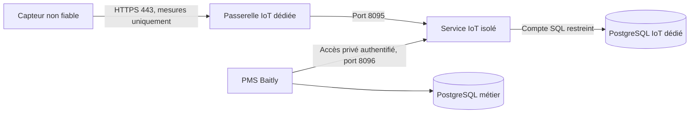

# Sécurité des échanges Baitly IoT

Ce document définit le modèle de menace et le contrat d'exploitation à respecter avant de connecter un appareil réel ou d'exposer le service. Les protections applicatives sont implémentées et testées ; l'isolation réseau décrite ici n'a pas été déployée. Un port HTTP distinct ne constitue pas une isolation entre processus.

## Frontières de confiance

Le transport MQTT est également disponible : voir [MQTT.md](MQTT.md). Le broker dédié exige mTLS, utilise des ACL par empreinte de certificat et sépare les CA des appareils et du récepteur. Le récepteur utilise la même validation transactionnelle que HTTP. Aucun accès du broker au PMS ou aux bases n'est nécessaire. Les références de pare-feu et de passerelle privée sont livrées dans `deploy/`, mais leur installation et la preuve d'isolation réseau restent à réaliser par CI/CD.

On suppose qu'un capteur peut être compromis et que sa clé peut être volée. On prévoit aussi le scénario plus grave d'une compromission du service IoT. Aucune mesure sonore n'est une instruction, une URL à appeler, une requête SQL ou une preuve de présence d'un voyageur.

Le PMS initie ses appels vers IoT. Le service IoT ne reçoit aucune clé du PMS, de Keycloak, de Redis ou de Kafka, ni aucun accès à la base métier. Le secret machine autorise uniquement l'API privée IoT ; il n'est accepté comme clé d'appareil et ne donne pas accès au PMS. Les identifiants de logement et d'organisation présents dans le registre ne sont pas des identifiants SQL ni des autorisations réseau.

## Flux réseau à autoriser par l'infrastructure

| Source | Destination | Autorisation |
| --- | --- | --- |
| Internet / appareils | Passerelle IoT, TCP 443 | Uniquement `POST /api/v1/measurements`, HTTPS obligatoire |
| Passerelle | Ingestion IoT, TCP 8095 | Uniquement ce service |
| PMS | Administration IoT, TCP 8096 | Réseau privé ; HTTPS ou tunnel chiffré hors boucle locale |
| Service IoT | PostgreSQL IoT, TCP 5432 | Son unique compte runtime ; TLS avec vérification du serveur hors même machine |
| Service IoT | PMS, PostgreSQL métier, Keycloak, Redis, Kafka, métadonnées cloud, Internet | Refuser les nouvelles connexions sortantes |
| Internet / capteurs | 8095, 8096, PostgreSQL et réseau privé | Refuser |

Le pare-feu doit permettre les réponses aux connexions initiées par le PMS, sans autoriser de nouvelle connexion IoT vers PMS. Ajouter seulement les besoins techniques explicitement validés, par exemple DNS et collecte de logs vers une destination fixe. Ne pas partager le réseau Docker du PMS, son socket Docker, ses volumes ni ses fichiers de secrets. Ne pas considérer une simple différence de nom de base ou de conteneur comme un cloisonnement.

Utiliser un hôte ou une VM IoT distincte du PMS, et un cluster PostgreSQL IoT distinct du cluster métier. Si les processus partagent provisoirement une machine de développement, cette séparation de sécurité n'est pas acquise. L'accès privé intermachines doit passer par une liaison chiffrée et une restriction de source ; mTLS pourra compléter l'identité machine, mais il n'est pas configuré par ce code.

`deploy/nginx-ingestion.conf` est une configuration de référence pour une passerelle dédiée sur le même hôte que les connecteurs locaux. Elle expose un seul chemin, filtre les méthodes et paramètres, limite tailles, délais, débits et connexions. Les certificats et son adaptation au réseau réel doivent être validés dans l'infrastructure avant déploiement. Elle ne remplace aucun fichier nginx du PMS et n'a pas été installée.

## Protections HTTP implémentées

La configuration nginx de référence n'a pas été validée par `nginx -t` localement : le binaire n'est pas installé. Cette validation reste requise dans le CI/CD d'infrastructure avec les certificats et chemins du déploiement réel.

- Port 8095 : uniquement l'ingestion POST. Port 8096 : uniquement l'API interne. La séparation utilise le port réel de la socket ; modifier `Host`, `Forwarded` ou `X-Forwarded-*` ne change pas les droits. Les deux écoutes sont locales par défaut.
- Une clé d'appareil aléatoire de 256 bits identifie un seul appareil. Seule son empreinte est stockée. L'appareil ne choisit ni organisation ni logement et ne peut ni lire l'historique ni créer ou administrer un appareil. Aucun accès anonyme, cookie de session ou mécanisme de connexion navigateur n'est proposé par le service IoT.
- La révocation et la rotation sont revérifiées sous verrou lors de l'ingestion. Une ancienne authentification préparée avant une rotation ne suffit pas à écrire après celle-ci. Les secrets sont masqués dans les représentations textuelles des objets de réponse.
- Au plus 4 Kio par corps, y compris sans Content-Length. JSON uniquement pour les corps non vides ; champs inconnus, doublons de clés, documents supplémentaires, profondeur supérieure à huit et chaînes excessives sont refusés. Aucun audio, fichier, URL ou commande n'entre dans le contrat.
- Avant la première requête SQL d'authentification : plafond global de 1200 tentatives d'ingestion par minute et de 240 par adresse de socket. Après authentification : 12 tentatives par appareil par minute, y compris les doublons et contenus invalides. HTTP 429 et `Retry-After: 60` indiquent de ralentir. Les fenêtres sont fixes : un pic au changement de minute reste possible.
- Les compteurs résident dans une mémoire bornée, au plus 4096 adresses et 4096 appareils par instance. Une table saturée refuse de nouvelles clés jusqu'à la fenêtre suivante. Les en-têtes de proxy ne servent pas à choisir l'adresse comptée. Derrière un proxy local, ses clients partagent donc le plafond applicatif de 240/minute ; le proxy assure la limite par IP réelle. Ce dimensionnement doit être testé et ajusté avant une montée en charge. Plusieurs réplicas multiplient ces plafonds ; une limite globale à la passerelle reste nécessaire.
- Le nombre de connexions et threads Tomcat, le pool SQL, les délais SQL et de verrou sont bornés. Le proxy doit absorber les corps lents avant leur transmission à Java : une limite de taille Java ne suffit pas contre Slowloris ou un DDoS.
- L'horodatage, la plage acoustique et l'idempotence sont validés avant persistance. Ces contrôles ne prouvent pas qu'un appareil dit la vérité : une clé volée permet encore de fabriquer des mesures valides pour cet appareil jusqu'à révocation.

Le PMS applique en plus ses contrôles de propriétaire et d'organisation avant toute gestion de capteur. Son client IoT utilise exclusivement les convertisseurs JSON, même si le PMS possède des bibliothèques XML pour d'autres intégrations. Il limite à huit les appels IoT simultanés par instance PMS, sans attente en file ; au-delà, l'appel échoue immédiatement. Une destination lente ne peut ainsi monopoliser tous les threads HTTP du PMS. Chaque lecture garde un délai de cinq secondes. Le client borne les réponses à 4 Mio, même sans Content-Length, limite la profondeur JSON et refuse les historiques excessifs ou les mesures invalides. Il refuse les redirections sans transmettre sa clé à une autre destination et ne relaie jamais le corps d'une erreur amont, qui pourrait contenir un secret. Les données IoT ne sont jamais exécutées comme SQL, HTML ou code ; les requêtes JDBC utilisent des paramètres. Les appareils simulés restent exclus des messages et alertes aux voyageurs.

## PostgreSQL : compte runtime distinct des migrations

Le profil `hardened` est obligatoire pour l'exploitation. Une écoute hors boucle locale est refusée sans ce profil. Un déploiement derrière un proxy local doit aussi activer explicitement `SPRING_PROFILES_ACTIVE=hardened` : le service ne peut pas deviner qu'un proxy expose sa boucle locale sur Internet.

En mode `hardened`, **seul le service IoT** désactive Liquibase au runtime. Ses migrations sont exécutées par un job CI/CD séparé avec une identité dédiée, avant le lancement du runtime. Aucun secret de migration ne doit être fourni au processus Java exposé. Les invariants Liquibase du PMS ne changent pas : ses migrations au boot restent activées et Hibernate reste en `validate`.

L'infrastructure doit provisionner automatiquement un rôle runtime avec :

- Connexion à sa seule base IoT, USAGE du schéma `public`.
- SELECT, INSERT et UPDATE sur `baitly_iot_devices`.
- SELECT et INSERT sur `baitly_iot_noise_measurements`.
- Aucun droit DELETE, TRUNCATE, création de table ou de schéma, aucun accès aux tables Liquibase ni aux autres tables.
- Aucun attribut superuser, création de rôle ou de base, réplication, bypass RLS ; aucune appartenance à un autre rôle, aucune propriété de base, de table ou de fonction.

Les privilèges hérités de PUBLIC doivent également être révoqués, notamment CREATE sur les schémas et TEMPORARY sur la base. Le propriétaire des objets et le rôle de migration restent distincts du runtime. Ces règles doivent passer par la configuration d'infrastructure et le CI/CD, sans intervention SQL manuelle en production. Le rôle d'entretien chargé de la rétention est distinct du runtime.

Au démarrage du profil `hardened`, `RuntimeDatabaseGuard` refuse les droits excessifs détectés, l'accès aux autres tables applicatives, l'exécution de fonctions utilisateur SECURITY DEFINER accessibles, les tables IoT absentes ou les droits nécessaires manquants. Il détecte aussi les autres bases applicatives du même cluster auxquelles le compte peut se connecter ; les bases système `postgres` et `template*` sont exclues de ce contrôle. Ce contrôle ne constitue pas une preuve de segmentation réseau ni un audit exhaustif des extensions et ACL du cluster.

## Ce qui reste nécessaire avant une exposition réelle

1. Livrer l'hébergement isolé, le pare-feu entrant et sortant et le PostgreSQL dédié par PR d'infrastructure ; tester explicitement les connexions interdites depuis le runtime IoT.
2. Valider la configuration de passerelle avec de vrais certificats, l'accès privé du PMS et les connexions SQL chiffrées. Les ports Java et PostgreSQL ne doivent jamais être publiés sur Internet.
3. Provisionner les rôles et le job de migration séparé ; démontrer un boot `hardened` avec le rôle runtime. Le service ne contient pas encore de workflow de déploiement.
4. Fixer la rétention, les quotas de disque, les sauvegardes et la procédure de restauration de la base IoT. Les plafonds HTTP ralentissent le remplissage mais ne remplacent pas un quota de stockage. La purge et ces politiques ne sont pas encore implémentées.
5. Ajouter des métriques sans secrets : 401/403/429, rejets JSON, latence, taille de file, pression SQL et espace disque. Définir les seuils d'alerte et la procédure de révocation d'une série compromise.
6. Qualifier le matériel : secrets distincts par appareil, absence de clé flotte universelle, stockage sécurisé, vérification des certificats TLS, firmware signé, mises à jour vérifiées et remplacement/révocation. Le simulateur ne prouve aucun de ces points.

Dans le logement, prévoir aussi un SSID ou VLAN IoT isolé du réseau des ordinateurs, équipements d'administration et voyageurs, avec les seuls accès sortants nécessaires. Cette protection dépend du routeur et du firmware choisis ; Baitly ne la configure pas et ne peut pas la garantir depuis son API.

Les tests couvrent les deux ports HTTP réels, les en-têtes falsifiés, la limitation avant SQL, la saturation des compteurs, les corps excessifs, les JSON ambigus, la rotation avant écriture et les privilèges d'un véritable rôle PostgreSQL restreint. Le test de privilèges crée puis détruit une base et un rôle aléatoires uniquement sur le cluster de test explicitement fourni.

La CI IoT ajoute une analyse OWASP Dependency Check dédiée, avec la même version de plugin que le backend. Elle échoue sur une vulnérabilité CVSS ≥ 7 ou une analyse impossible ; la clé NVD passe par une variable d'environnement. Cette analyse réseau n'a pas été exécutée localement et ne constitue pas encore un résultat d'audit des dépendances. La première synchronisation NVD peut être longue. La règle de protection de branche doit rendre ce job obligatoire avant intégration ; ajouter un job au YAML ne configure pas cette règle GitHub.

Références : [autorisations Spring Security](https://docs.spring.io/spring-security/reference/6.5/servlet/authorization/authorize-http-requests.html), [privilèges PostgreSQL](https://www.postgresql.org/docs/16/ddl-priv.html), [appartenance aux rôles PostgreSQL](https://www.postgresql.org/docs/16/role-membership.html), [limites de connexions Nginx](https://nginx.org/en/docs/http/ngx_http_limit_conn_module.html).
